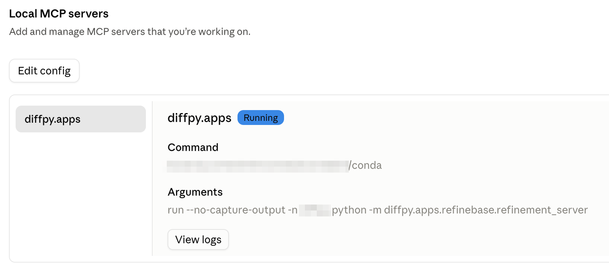
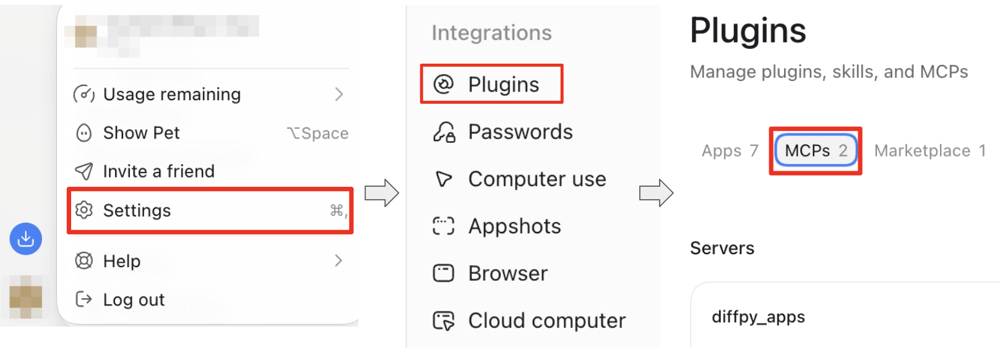

:tocdepth: -1

DiffPy Agent Interface
=======================
This interface is provided for agents, e.g. ``Claude Code`` and ``Codex``,
which mainly utilizes the "tool" concept applied in most agent frameworks.
After connecting these tools to an agent, users can invoke DiffPy
functionalities and automate PDF refinements through conversation.

After you have installed ``diffpy.apps``, the next step is to connect it to
your local agent. ``diffpy.apps`` server should be able to connect to any
Desktop agent that supports the MCP (Model Context Protocol), and we have provided
instructions for :ref:`connect_claude_desktop` and :ref:`connect_chatgpt_desktop` below.

.. _mcp_setup:

Setup
-----

.. _connect_claude_desktop:
Connect to Claude Desktop
~~~~~~~~~~~~~~~~~~~~~~~~~
1. Copy the path to the conda executable. There are many commands available,
here are two examples

.. code-block:: bash

    whereis conda  # linux or macOS terminal
    where.exe conda  # windows powershell

2. Install ``Claude Desktop`` (hereafter referred to as ``Claude``).
3. Open ``Claude`` and open "Settings".
4. Navigate to the "Developer" section.
5. In the "Local MCP servers" region, click "Edit Config" and Open the configuration file. It's name should be ``claude_desktop_config.json``.

.. Figure:: img/claude_edit_config.png
    :align: center

    Figure 1: Screenshot of "Edit Config" in ``Claude``.

6. Add the following configuration, and replace ``</path/to/conda>`` with the path to your conda executable and ``<conda_env_name>`` with the name of your conda environment.

.. code-block:: json

    "mcpServers": {
        "diffpy.apps": {
            "command": "</path/to/conda>",
            "args": [
            "run",
            "--no-capture-output",
            "-n",
            "<conda_env_name>",
            "python",
            "-m",
            "diffpy.apps.refinebase.refinement_server"
            ]
        }
    }

For example, If Mr Neutron installed ``diffpy.apps`` in the ``diffpy_apps``
conda environment, his ``claude_desktop_config.json`` in the Linux/macOS system
would look like this:

.. code-block:: json

    {
        "mcpServers": {
            "diffpy.apps": {
            "command": "/path/to/bin/conda",
            "args": [
                "run",
                "--no-capture-output",
                "-n",
                "diffpy_apps",
                "python",
                "-m",
                "diffpy.apps.refinebase.refinement_server"
            ]
            }
        },
        "other_configurations": "other_configurations"
    }

, and in the Windows system, it would look like this:

.. code-block:: json

    {
        "mcpServers": {
            "diffpy.apps": {
            "command": "C:\\path\\to\\bin\\conda.bat",
            "args": [
                "run",
                "--no-capture-output",
                "-n",
                "diffpy_apps",
                "python",
                "-m",
                "diffpy.apps.refinebase.refinement_server"
            ]
            }
        },
        "other_configurations": "other_configurations"
    }

7. Restart the ``Claude``.

8. Go to the same "Local MCP servers" section and verify that the
``diffpy.apps`` server is listed and active.

    Figure 2: Screenshot of active ``diffpy.apps`` server in ``Claude``.

.. _connect_chatgpt_desktop:
Connect to ChatGPT Desktop
~~~~~~~~~~~~~~~~~~~~~~~~~~
1. Copy the path to the conda executable. There are many commands available,
here are two examples

.. code-block:: bash

    whereis conda  # linux or macOS terminal
    where.exe conda  # windows powershell

1. Install ``ChatGPT Desktop`` (hereafter referred to as ``ChatGPT``).
2. Open ``~/.codex/config.toml``.
3. Add the following configuration, and replace ``<path/to/python>`` with the path to the Python executable in your conda environment.

.. code-block:: toml

    [mcp_servers.diffpy_apps]
    command =  "<path/to/conda>"
    args = [
        "run",
        "--no-capture-output",
        "-n",
        "<conda_env_name>",
        "python",
        "-m",
        "diffpy.apps.refinebase.refinement_server"
    ]

.. note::

    In Windows, please make sure the full path is separated by
    double backslashes (e.g., ``C:\\path\\to\\bin\\conda.bat``).

4. Restart the ``ChatGPT``.

5. Open "Settings", and navigate to the "Integration" section. Open
"Plugins" tab, and verify that the ``diffpy.apps`` server is listed in the
"MCPs" field and active.

    Figure 2: Screenshot of active ``diffpy.apps`` server in ``ChatGPT``.

Example Usage
-------------
Once you ``diffpy.apps`` MCP server is running, you can interact with it
through the agent.

Here is a simple example of conducting Ni structure refinement.

1. Download the :download:`Ni.gr<data/Ni.gr>` and :download:`Ni.cif<data/Ni.cif>`
files to your working directory.

2. Open ``Claude``, launch the "Code" tab or select "Cowork" in "Chat or Cowork"
tab.

3. Add the working directory folder to the ``Claude``.

4. Start your conversation! For example, try to ask
*Tell me what can diffpy.apps do and how it can help me refine the
Ni.cif against the Ni.gr.*

How to add Diffpy agent skills
------------------------------

Another advantage of using the Diffpy agent is that its behavior can be
tuned to suit specific tasks and workflows by adding custom skills and
context.

We have prepared a basic skill that you can readily deploy and use with the
Diffpy agent.

To use it, run

.. code-block:: bash

    diffpy-app agentify

``claude`` and ``codex`` agent skills are supported. By default, it is
deployed as the ``claude`` agent skill. Use the ``--agent`` option to
specify the specific agent:

.. code-block:: bash

    diffpy-app agentify --agent codex

To deploy the agentic skill to the system directory, use the ``--system`` flag:

.. code-block:: bash

    diffpy-app agentify --system

To update the existing ``diffpy.cmi`` agentic skill, use the ``--update`` flag:

.. code-block:: bash

    diffpy-app agentify --update

How to contribute Diffpy agent skills
-------------------------------------

Skills are simply markdown files providing context for the agents.
They help to enable the agent to follow the best practices, and to
efficiently perform workflows sharing similar patterns.
Please refer to the documentation from your favorite agent platform, such as
`Claude Documentation <https://platform.claude.com/docs/en/agents-and-tools/agent-skills/overview>`_
for more details.

``diffpy-app agentify`` fetches our prepared agent skills from
`cmi-agent-skills <https://github.com/diffpy/cmi-agent-skills>`_  GitHub repository.
If you are willing to contribute your skills, you can submit Pull Requests in
the same repository. Thanks for sharing your work with the community!
