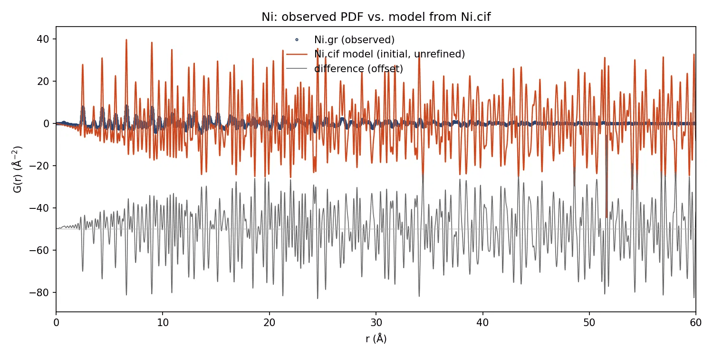
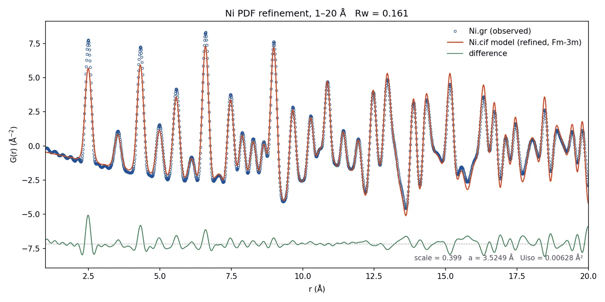

:tocdepth: -1

DiffPy Agent Interface
=======================
This interface is provided for agents, e.g. ``Claude Code`` and ``Codex``,
which mainly utilizes the "tool" concept applied in most agent frameworks.
After connecting these tools to an agent, users can invoke ``DiffPy``
functionalities and automate PDF refinements through conversation.

.. _mcp_setup:

Setup
-----

After you have installed ``diffpy.apps``, the next step is to connect it to
your local agent. The configurations are required for the first time only.

``diffpy.apps`` communicates with the agent through the
MCP (Model Context Protocol), and thus can be configured for any agents
that support the MCP. Here we provide the setup instructions for ``Claude``
agent and ``ChatGPT`` agent.

.. _connect_claude:

For Claude User
~~~~~~~~~~~~~~~~

How to connect to Claude Code Terminal
^^^^^^^^^^^^^^^^^^^^^^^^^^^^^^^^^^^^^^
1. Install ``Claude Code`` terminal.

2. Copy the path to the ``conda`` executable. There are many commands available,
and here are two examples:

.. code-block:: bash

    whereis conda  # linux or macOS terminal
    where.exe conda  # windows powershell

3. Replace ``<path/to/conda>`` with the path to your ``conda`` executable and ``<conda_env_name>`` with the name of your conda environment, then run the following command:

.. code-block:: bash

    claude mcp add --scope local diffpy-apps -- \
    <path/to/conda> run --no-capture-output -n <conda_env_name> \
    python -m diffpy.apps.parametric_refinement.refinement_server \

.. note::

    The ``claude mcp add`` command saves the server configuration according to the
    scope you specify:

    ``--scope local`` adds it to the project-specific section of
    ``~/.claude.json``.

    ``--scope project`` adds it to the project's ``.mcp.json``.

    ``--scope user`` adds it to the top-level configuration in
    ``~/.claude.json``.

    The default scope is ``local``.

.. note::

    ``diffpy.apps`` MCP server is launched by ``conda`` instead of the commonly
    used ``uv`` because one of ``diffpy.apps`` core dependencies, ``diffpy.srreal`` is
    better managed via ``conda``

4. Restart the ``Claude CLI``
5. Run the following command in the conversation with ``Claude CLI`` to verify the connection:

.. code-block:: bash

    /mcp

6. Check :ref:`agent_example` to see how to use it to perform PDF refinement.

7. To remove the configuration, run the following command in the the terminal:

.. code-block:: bash

    claude mcp remove "diffpy-apps" -s local

replace ``local`` with the actual scope you used when adding the configuration.

How to connect to Claude Desktop
^^^^^^^^^^^^^^^^^^^^^^^^^^^^^^^^
1. Install ``Claude Code`` Desktop.
2. Open ``Claude Desktop`` and open "Settings".
3. Navigate to the "Developer" section.
4. In the "Local MCP servers" region, click "Edit Config" and Open the configuration file. Its name should be ``claude_desktop_config.json``.

.. Figure:: img/claude_edit_config.png
    :align: center

    Figure 1: Screenshot of "Edit Config" in ``Claude Desktop``.

5. Copy the path to the conda executable. There are many commands available,
here are two examples

.. code-block:: bash

    whereis conda  # linux or macOS terminal
    where.exe conda  # windows powershell

3. Replace ``<path/to/conda>`` with the path to your ``conda`` executable and ``<conda_env_name>`` with the name of your conda environment, then add the configuration as shown below.

.. code-block:: json

    "mcpServers": {
        "diffpy.apps": {
            "command": "</path/to/conda>",
            "args": [
            "run",
            "--no-capture-output",
            "-n",
            "<conda_env_name>",
            "python",
            "-m",
            "diffpy.apps.parametric_refinement.refinement_server"
            ]
        }
    }

For example, If Mr Neutron installed ``diffpy.apps`` in the ``diffpy_apps``
conda environment, his ``claude_desktop_config.json`` in the Linux/macOS system
would look like this:

.. code-block:: json

    {
        "mcpServers": {
            "diffpy.apps": {
            "command": "/Users/mr_neutron/miniconda3/bin/conda",
            "args": [
                "run",
                "--no-capture-output",
                "-n",
                "diffpy.apps_env",
                "python",
                "-m",
                "diffpy.apps.parametric_refinement.refinement_server"
            ]
            }
        },
        "other_configurations": "other_configurations"
    }

, and in the Windows system, it would look like this:

.. code-block:: json

    {
        "mcpServers": {
            "diffpy.apps": {
            "command": "C:\\Users\\mr_neutron\\miniconda3\\condabin\\conda.bat",
            "args": [
                "run",
                "--no-capture-output",
                "-n",
                "diffpy.apps_env",
                "python",
                "-m",
                "diffpy.apps.parametric_refinement.refinement_server"
            ]
            }
        },
        "other_configurations": "other_configurations"
    }

7. Restart the ``Claude``.

8. Go to the same "Local MCP servers" section and verify that the
``diffpy.apps`` server is listed and active.

.. figure:: img/claude_validate.png
    :align: center

    Figure 2: Screenshot of active ``diffpy.apps`` server in ``Claude``.

9. Check :ref:`agent_example` to see how to use it to perform PDF refinement.

10. To remove the configuration, remove the added block from the configuration file.

.. _connect_chatgpt:

For ChatGPT users
~~~~~~~~~~~~~~~~~

1. Install the Desktop version or Terminal version of ``ChatGPT``.

2. Open the configuration file ``~/.codex/config.toml``.

3. Copy the path to the conda executable. There are many commands available,
here are two examples

.. code-block:: bash

    whereis conda  # linux or macOS terminal
    where.exe conda  # windows powershell

4. Replace ``<path/to/conda>`` with the path to your ``conda`` executable and ``<conda_env_name>`` with the name of your conda environment, then add the configuration as shown below.

.. code-block:: toml

    [mcp_servers.diffpy_apps]
    command =  "<path/to/conda>"
    args = [
        "run",
        "--no-capture-output",
        "-n",
        "<conda_env_name>",
        "python",
        "-m",
        "diffpy.apps.parametric_refinement.refinement_server"
    ]

.. note::

    In Windows, please make sure the full path is separated by
    double backslashes (e.g., ``C:\\path\\to\\bin\\conda.bat``).

4. Restart the ``ChatGPT Desktop`` or ``Codex``.

5. Verify the connection of the ``diffpy.apps`` server.

For ``ChatGPT`` Desktop, open "Settings", and navigate to the "Integration" section. Open
"Plugins" tab, and verify that the ``diffpy.apps`` server is listed in the
"MCPs" field and active.

.. figure:: img/chatgpt_validate.png
    :align: center

    Figure 2: Screenshot of active ``diffpy.apps`` server in ``ChatGPT``.

For ``ChatGPT`` Terminal (``Codex``), enter the following command in the conversation with the agent:

.. code-block:: bash

    /mcp

6. Check :ref:`agent_example` to see how to use it to perform PDF refinement.

7. To remove the configuration, delete the added block from the configuration file.

.. _agent_example:

Example Usage
-------------

After successfully connecting the ``diffpy.apps`` server to your agent,
you can interact with it to perform PDF refinement tasks.
Please see :ref:`mcp_setup` for instructions.

Here we assume that you are using ``Claude Code`` Desktop as your agent. If you are
using a different agent, please replace ``Claude`` in the following steps.

1. Download the :download:`Ni.gr<data/Ni.gr>` and :download:`Ni.cif<data/Ni.cif>`
files to your working directory.

2. Open ``Claude Code`` Desktop, launch the "Code" tab or select "Cowork" in "Chat or Cowork"
tab.

.. note::

    In some Desktop distributions, the developers provide separate
    channels for agent interactions, and the
    Chat-only window may not have access to the MCP servers. When
    this happens, make sure to switch to the Agent interaction channel.

    Terminal distributions can usually discover the MCP servers automatically.

3. Add the working directory folder to the ``Claude Code`` Desktop.

4. Start your conversation! Explore your preferred way to communicate with the agent.

For example, Mr Neutron follows the steps and started a conversation with the agent:

.. code-block:: text

    > (Mr Neutron) Can you find ``Ni.gr`` and ``Ni.cif``?
    > (Agent) Yes, I found both files in your ...
    > (Mr Neutron) Use diffpy.apps MCP server
        1. Add `Ni.gr` as Profile
        2. Add `Ni.cif` as PDF model
        3. Plot them together
    > (Agent) Done.

and the following image shows the result:

    Ni PDF plot(before refinement). Generated by Claude Code

As a PDF expert, Mr Neutron knows what's wrong, so he continued his requests:

.. code-block:: text

    > (Mr Neutron) The plot looks incorrect. Now refine the Ni structure:
        1. constrain Ni structure according to it's spacegroup symmetry
        2. refine ni.scale and other space group symmetry parameters
        3. fit it over the range from 1-20 angstrum for simplicity
    > (Agent) Done.

and the following image shows the refined result:

    Ni PDF plot(after refinement). Generated by Claude Code

Mr Neutron is satisfied with the refined result.

.. _diffpy-agent-skills:

How to add Diffpy agent skills
------------------------------

In previous example, Mr Neutron still needs to write down the sequence of
actions for the simple PDF refinement task. The effort can be further reduced
by adding our prepared agent skills into the context.

To use it, run the following command in the terminal after installing ``diffpy.apps``.

.. code-block:: bash

    diffpy-app agentify

``claude`` and ``codex`` agent skills are supported. By default, it is
deployed as the ``claude`` agent skill. Use the ``--agent`` option to
specify the specific agent:

.. code-block:: bash

    diffpy-app agentify --agent codex

To deploy the agentic skill to the system directory, use the ``--system`` flag:

.. code-block:: bash

    diffpy-app agentify --system

To update the existing ``diffpy.cmi`` agentic skill, use the ``--update`` flag:

.. code-block:: bash

    diffpy-app agentify --update

When the agent fails
--------------------
An agent using ``diffpy.apps`` is not guaranteed to handle every complicated PDF
refinement task by itself. Its success relies on tools in
``diffpy.apps`` being executed in the correct order, and the knowledge of
how to generate the correct sequence of tool invocations comes from the
LLM itself, the agent skills we have prepared, the local context and
the user's prompt.

When the agent cannot handle a situation automatically, the user may need to
intervene and manually guide the refinement process by providing
instructions about the expected tool and arguments.

Try to ask *"Please summarize available tools inside diffpy.apps concisely."*,
and you will get the response similarly to this

.. code-block:: none

    diffpy.apps is a set of 28 tools for running diffpy.srfit-style refinements,
    such as PDF fits, in a stateful session. Here they are by job:
    ...

Getting familiar with the available tools and their usage will allow you to
use ``diffpy.apps`` capabilities in your prompt effectively.
General instructions are usually sufficient for the agent to find
the correct tools.

.. _contribute_cmi_skills:

How to contribute Diffpy agent skills
-------------------------------------

Skills are simply markdown files providing context for the agents.
They help to enable the agent to follow the best practices, and to
efficiently perform workflows sharing similar patterns.
Please refer to the documentation from your favorite agent platform, such as
`Claude Documentation <https://platform.claude.com/docs/en/agents-and-tools/agent-skills/overview>`_,
for more details.

``diffpy-app agentify`` fetches our prepared agent skills from
`cmi-agent-skills <https://github.com/diffpy/cmi-agent-skills>`_  GitHub repository.
If you are willing to contribute your skills, you can submit Pull Requests in
the same repository.
We expect the description of the workflows to follow the consistent format and wording
conventions, i.e. the diffpy macro language. Please see :doc:`diffpy-macro` for more
details.  Thanks for sharing your work with the community!
